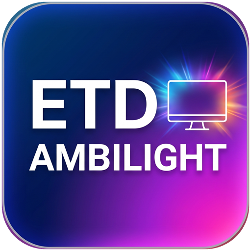
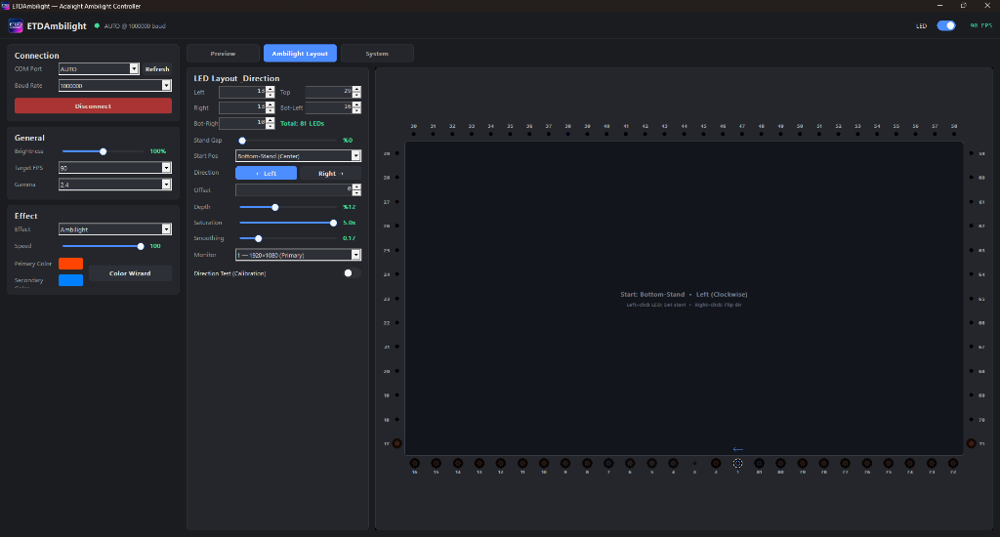
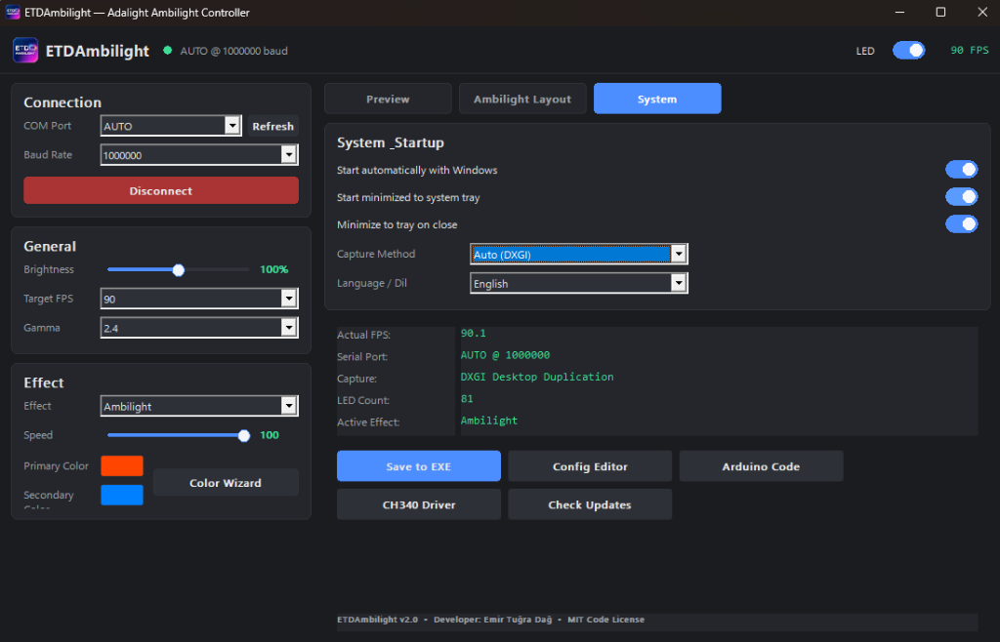

<p align="center">
  
</p>

<h1 align="center">ETDAmbilight</h1>

<p align="center">
  Windows için hafif, sıfır bağımlılıklı C++ (Win32 / DXGI) Adalight Ambilight kontrolcüsü.<br/>
  Lightweight, zero-dependency C++ (Win32 / DXGI) Adalight Ambilight controller for Windows.<br/>
  <b>Geliştirici / Developer: Emir Tuğra Dağ</b>
</p>

## 📸 Ekran Görüntüleri / Screenshots

| Ambilight Düzeni & Canlı Önizleme / Layout & Preview | Sistem & Başlangıç / System & Startup |
| :---: | :---: |
|  |  |

---

## 🇹🇷 Türkçe

**ETDAmbilight**, monitör kenarlarındaki renkleri düşük işlemci kullanımıyla yakalayıp seri port (Adalight protokolü, varsayılan `1.000.000` baud) üzerinden Arduino tabanlı adreslenebilir LED şeritlerine aktaran tek parça (`ETDAmbilight.exe`) Windows uygulamasıdır.

### Özellikler

- **DXGI Desktop Duplication + GDI Yedeği:** Ekran değişmediğinde CPU/GPU uyur; RDP veya uyumluluk modunda otomatik GDI yakalamaya geçer.
- **Esnek LED Düzeni & Canlı Önizleme:** Sol, Üst, Sağ, Alt-Sol, Alt-Sağ kenar sayıları, monitör ayağı boşluğu, başlangıç köşesi, yön (saat yönü / tersi) ve kaydırma (offset) ayarları. Önizlemede LED'e sol tıklayarak başlangıç noktasını seçebilir, sağ tıklayarak yönü çevirebilirsiniz.
- **Renk Kalibrasyon Sihirbazı:** Kanal sırası (`RGB`, `GRB`, vb.), beyaz dengesi (`R/G/B` kazanç), gamma ve örnek sahne üzerinden canlı ayarlama.
- **12 Dahili Efekt:** Ambilight, Rainbow, Rainbow Wave, Ateş, Nefes, Renk Silme, Strobe, Gradient, Kıvılcım, Polis, Sabit Renk ve Yön Testi (Kalibrasyon).
- **Ayarların Kalıcılığı ve Güncelleme:** Ayarlar hem `HKCU\Software\ETDAmbilight` Registry anahtarına hem de doğrudan `ETDAmbilight.exe` dosyasının sonuna yazılır. Yeni sürüm kurulduğunda kurulum sihirbazı mevcut ayarları silmeden korur ve günceller.
- **Türkçe & İngilizce Arayüz:** Uygulama ve kurulum sihirbazı Sistem sekmesinden veya kurulum başından canlı olarak Türkçe / İngilizce değiştirilebilir.

### Kurulum

1. [Releases](https://github.com/emirtugra-dag/ETDAmbilight/releases) sayfasından **`ETDAmbilight-Setup.exe`** dosyasını indirin.
2. Kurulum sihirbazı sistem gereksinimlerini (DXGI / CH340 USB-Seri sürücüsü) denetler, gerekirse CH340 sürücü kurulumunu başlatır ve mevcut bir sürüm varsa ayarlarınızı silmeden günceller.
3. İsterseniz kurulumsuz olarak doğrudan taşınabilir **`ETDAmbilight.exe`** dosyasını da kullanabilirsiniz.

### Arduino Bağlantısı (FastLED)

Uygulama içindeki **Sistem → Arduino Kodu** penceresi seçtiğiniz LED sayısına ve baud hızına göre hazır kodu üretir:

```cpp
#include <FastLED.h>

#define NUM_LEDS     60
#define DATA_PIN     6
#define LED_TYPE     WS2812B
#define COLOR_ORDER  GRB
#define BAUD_RATE    1000000

CRGB leds[NUM_LEDS];

void setup() {
  Serial.begin(BAUD_RATE);
  Serial.setTimeout(50);
  FastLED.addLeds<LED_TYPE, DATA_PIN, COLOR_ORDER>(leds, NUM_LEDS);
  FastLED.setBrightness(255);
  FastLED.clear(true);
  Serial.print("Ada\n");
}

void loop() {
  if (Serial.available() < 6) return;
  if (Serial.read() != 'A') return;
  if (Serial.read() != 'd') return;
  if (Serial.read() != 'a') return;

  uint8_t hi  = Serial.read();
  uint8_t lo  = Serial.read();
  uint8_t chk = Serial.read();
  if (chk != (hi ^ lo ^ 0x55)) return;

  uint16_t count = ((uint16_t)hi << 8 | lo) + 1;
  uint16_t readCount = (count <= NUM_LEDS) ? count : NUM_LEDS;
  size_t need = (size_t)readCount * 3;
  if (Serial.readBytes((char*)leds, need) != need) return;

  for (uint16_t i = readCount; i < count; ++i) {
    uint8_t dump[3];
    if (Serial.readBytes((char*)dump, 3) != 3) break;
  }

  FastLED.show();
}
```

### Derleme

MinGW-w64 `g++` (C++20) ile doğrudan derlenir:

```bat
build.bat
```

Çıktılar `dist\ETDAmbilight.exe` ve `dist\ETDAmbilight-Setup.exe` olarak oluşturulur.

### Yasal Bildirim ve Sorumluluk Reddi (🇹🇷)

- **Bağımsız Geliştirici:** Bu yazılım bağımsız bireysel geliştirici **Emir Tuğra Dağ** tarafından geliştirilmiştir. Herhangi bir şirket, kurum veya tüzel kişilikle bağlantılı değildir.
- **Kaynak Kod Lisansı (MIT):** Tüm kaynak kodları, betikler ve çalışma mantığı standart **MIT Lisansı** (`Copyright (c) 2026 Emir Tuğra Dağ`) altındadır.
- **Marka ve Logo Koruması:** `ETDAmbilight` ismi, resmi logolar (`.png`, `.jpg`) ve uygulama simgeleri (`.ico`) **MIT Lisansı kapsamının dışındadır**; fikri mülkiyet hakkı **Emir Tuğra Dağ**'a aittir. Kodları çatallayan (fork) veya türev proje geliştirenlerin proje ismini, logoları ve simgeleri değiştirmesi zorunludur.
- **Sorumluluk Reddi (AS IS):** Yazılım "olduğu gibi" ve hiçbir garanti olmaksızın sunulmaktadır. Kullanımından veya kullanılamamasından doğabilecek veri kayıpları, sistem sorunları, donanım/LED hasarları veya doğrudan/dolaylı hiçbir zarardan **Emir Tuğra Dağ** sorumlu tutulamaz. Tüm risk kullanıcıya aittir; güncelleme veya teknik destek sağlama taahhüdü yoktur.

---

## 🇬🇧 English

**ETDAmbilight** is a standalone native Windows (`ETDAmbilight.exe`) Ambilight and addressable LED controller written in C++ (Win32 / DirectX DXGI). It captures screen edge colors with minimal CPU overhead and streams them over serial using the Adalight protocol (`1,000,000` baud default).

### Features

- **DXGI Desktop Duplication + GDI Fallback:** Sleeps at 0% capture load when the screen is idle or LEDs are off; automatically falls back to GDI under RDP or unsupported environments.
- **Flexible Layout & Interactive Preview:** Configure Left, Top, Right, Bottom-Left, Bottom-Right LED counts, monitor stand gap, starting corner, direction (CW/CCW), and offset. Left-click any LED in the preview to set LED #1, or right-click to flip direction.
- **Color Calibration Wizard:** Interactive 4-step wizard for channel order (`RGB`, `GRB`, etc.), white balance (`R/G/B` gain), gamma, and live sample scene tuning.
- **12 Built-in Effects:** Ambilight, Rainbow, Rainbow Wave, Fire, Breathing, Color Wipe, Strobe, Gradient, Sparkle, Police, Solid Color, and Direction Test (Calibration).
- **Persistent Settings & Safe Updates:** Settings are saved both to `HKCU\Software\ETDAmbilight` and appended to the EXE footer. Running the setup wizard over an existing installation updates the application in place without losing your settings.
- **Bilingual UI (Turkish & English):** Switch languages live from the System tab or inside the Setup Wizard.

### Installation

1. Download **`ETDAmbilight-Setup.exe`** from the [Releases](https://github.com/emirtugra-dag/ETDAmbilight/releases) page.
2. The wizard checks system requirements (DXGI support and CH340 USB-Serial driver), offers CH340 driver installation if missing, and preserves existing settings when updating.
3. Alternatively, you can run the standalone **`ETDAmbilight.exe`** directly without installation.

### Building from Source

Requires MinGW-w64 `g++` (C++20) and `windres` in `PATH`:

```bat
build.bat
```

Outputs are generated in `dist\ETDAmbilight.exe` and `dist\ETDAmbilight-Setup.exe`.

### Legal Notice & Disclaimer (🇬🇧)

- **Independent Developer:** This project is created and maintained by independent individual developer **Emir Tuğra Dağ**, with no corporate or institutional entity.
- **Source Code License (MIT):** All source code, build scripts, and runtime logic are open source under the standard **MIT License** (`Copyright (c) 2026 Emir Tuğra Dağ`). See [LICENSE](LICENSE) for full terms.
- **Brand & Logo IP Policy:** The project name (`ETDAmbilight`), official logos (`.png`, `.jpg`), and application icons (`.ico`) are **excluded from the MIT License**; all intellectual property rights belong exclusively to **Emir Tuğra Dağ**. Forks and derivative projects must use their own name, logos, and icons.
- **Disclaimer of Liability (AS IS):** This software is provided "AS IS", without warranty of any kind. **Emir Tuğra Dağ** shall not be held liable under any circumstances for data loss, system lockouts, hardware/software damage, or any direct or indirect damages arising from using or being unable to use this software. All usage risk rests solely with the user, with no obligation for updates or technical support.
